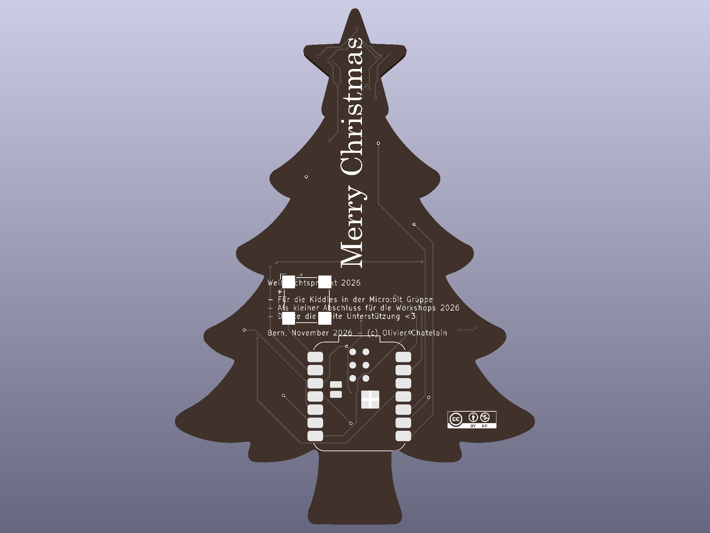

# AITY Weihnachtsbaum 2026

Ein interaktives Weihnachtsbaum-PCB für **Seeed Studio XIAO RP2040** oder **Seeed Studio XIAO ESP32-C6** mit 60 adressierbaren NeoPixel-LEDs, einem Piezo-Lautsprecher/Buzzer und Testpunkten.

| Vorderseite (3D-Render) | Rückseite (3D-Render) |
| :---: | :---: |
|  |  |

## Hardware-Spezifikationen

- **Mikrocontroller:** Seeed Studio XIAO RP2040 oder Seeed Studio XIAO ESP32-C6
- **LEDs:** 60 × WS2812B NeoPixel RGB-LEDs an Pin `D10`
- **Audio:** Lautsprecher/Buzzer an Pin `D0`
- **Testpunkte:** TP101 – TP109 an den Pins `D1` – `D9`

## ASCII-Pinout-Diagramm

Beide XIAO-Boards teilen sich denselben 14-Pin-Formfaktor:

```
                        +-------------------+
                        |   USB-C           |
                        |  [ Seeed XIAO ]   |
                        | [RP2040/ESP32-C6] |
(Lautspr. LS101) D0/A0 -| [1]          [14] |- 5V (VDD Spannung)
  (Testpunkt 1)  D1/A1 -| [2]          [13] |- GND
  (Testpunkt 3)  D2/A2 -| [3]          [12] |- 3V3 (NC)
  (Testpunkt 4)  D3/A3 -| [4]          [11] |- D10/MOSI (60 × NeoPixel LEDs)
  (Testpunkt 5) D4/SDA -| [5]          [10] |- D9/MISO  (Testpunkt 2)
  (Testpunkt 8) D5/SCL -| [6]           [9] |- D8/SCK   (Testpunkt 7)
  (Testpunkt 6)  D6/TX -| [7]           [8] |- D7/RX    (Testpunkt 9)
                        +-------------------+
```

### Pin-Belegungstabelle

| Pin-Nr. | XIAO-Pin | RP2040 GPIO | ESP32-C6 GPIO | CircuitPython-Pin | Funktion / Anschluss |
|---|---|---|---|---|---|
| 1 | A0 / D0 | GPIO26 | GPIO0 / PA02 | `board.D0` | Lautsprecher (LS101) |
| 2 | A1 / D1 | GPIO27 | GPIO1 / PA04 | `board.D1` | Testpunkt 1 (TP101) |
| 3 | A2 / D2 | GPIO28 | GPIO2 / PA10 | `board.D2` | Testpunkt 3 (TP103) |
| 4 | A3 / D3 | GPIO29 | GPIO3 / PA11 | `board.D3` | Testpunkt 4 (TP104) |
| 5 | SDA / D4 | GPIO6 | GPIO19 / PA08 | `board.D4` | Testpunkt 5 (TP105) |
| 6 | SCL / D5 | GPIO7 | GPIO20 / PA09 | `board.D5` | Testpunkt 8 (TP108) |
| 7 | TX / D6 | GPIO0 | GPIO21 / PB08 | `board.D6` | Testpunkt 6 (TP106) |
| 8 | RX / D7 | GPIO1 | GPIO22 / PB09 | `board.D7` | Testpunkt 9 (TP109) |
| 9 | SCK / D8 | GPIO2 | GPIO23 / PA07 | `board.D8` | Testpunkt 7 (TP107) |
| 10 | MISO / D9 | GPIO4 | GPIO9 / PA05 | `board.D9` | Testpunkt 2 (TP102) |
| 11 | MOSI / D10 | GPIO3 | GPIO18 / PA06 | `board.D10` | NeoPixel LEDs Data In |
| 12 | 3V3 | 3V3 | 3V3 | `board.3V3` | Nicht verbunden (NC) |
| 13 | GND | GND | GND | `board.GND` | Masse (GND) |
| 14 | 5V | 5V | 5V | `board.5V` | 5V Stromversorgung (VDD) |

---

## Anleitungen & Plattform-Setup

Detaillierte Schritt-für-Schritt-Anleitungen zur Installation (Web-Only ohne lokale Tools):

- [**HOWTO_RP2040.md**](HOWTO_RP2040.md) — Anleitung für **Seeed Studio XIAO RP2040**
- [**HOWTO_ESP32-C6.md**](HOWTO_ESP32-C6.md) — Anleitung für **Seeed Studio XIAO ESP32-C6**
- [**esp32c6-portal/README.md**](esp32c6-portal/README.md) — **ESP32-C6 Zero-Install WLAN-Captive-Portal** (automatische Browser-Weiterleitung nach WLAN-Verbindung, volle Licht-/Melodie-/Preset-Steuerung)

---

## Beispiel-Skript (CircuitPython): Regenbogen-Animation

Dieses Skript als `code.py` auf das Board kopieren und sicherstellen, dass `neopixel.mpy` im Ordner `lib/` liegt:

```python
import time
import board
import neopixel

try:
    from rainbowio import colorwheel
except ImportError:
    def colorwheel(pos):
        """Erzeugt Regenbogenfarben für Positionen 0–255."""
        pos = int(pos) % 256
        if pos < 85:
            return (pos * 3, 255 - pos * 3, 0)
        elif pos < 170:
            pos -= 85
            return (255 - pos * 3, 0, pos * 3)
        else:
            pos -= 170
            return (0, pos * 3, 255 - pos * 3)

NUM_LEDS = 60
DATA_PIN = board.D10
BRIGHTNESS = 0.3  # Helligkeit (0.0 bis 1.0)

pixels = neopixel.NeoPixel(
    DATA_PIN,
    NUM_LEDS,
    brightness=BRIGHTNESS,
    auto_write=False
)

def rainbow_cycle(wait=0.01):
    """Animiert einen weichen Regenbogen über alle 60 LEDs."""
    for j in range(256):
        for i in range(NUM_LEDS):
            pixel_index = (i * 256 // NUM_LEDS) + j
            pixels[i] = colorwheel(pixel_index & 255)
        pixels.show()
        time.sleep(wait)

print("Starte Regenbogen-Animation auf 60 NeoPixel-LEDs...")

while True:
    rainbow_cycle(wait=0.01)
```

## Schnellstart

1. CircuitPython installieren (siehe [HOWTO_RP2040.md](HOWTO_RP2040.md) oder [HOWTO_ESP32-C6.md](HOWTO_ESP32-C6.md)) — oder direkt über die **GitHub-Pages-Weboberfläche** flashen.
2. `neopixel.mpy` (aus `circuitpython/default/lib/`) in den Ordner `lib/` auf dem Board kopieren.
3. Das gewünschte Skript (z. B. `circuitpython/code.unified.py` oder `circuitpython/code.portal.py`) als `code.py` auf dem Board speichern.
