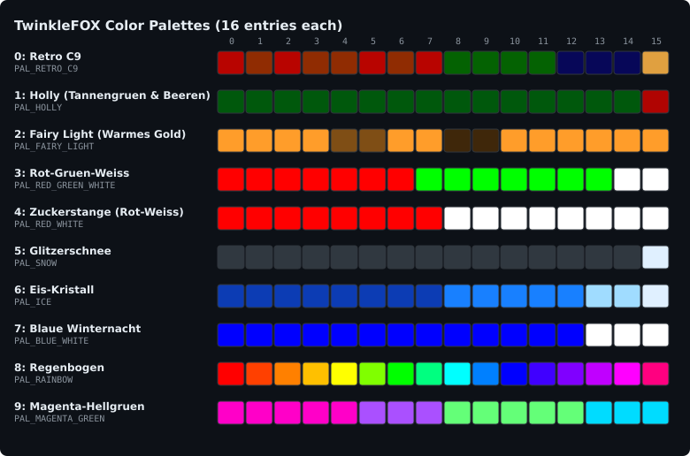

# CircuitPython Libraries (`lib/`)

Helper modules for the 60-LED Xmas tree PCB, compatible with the **Seeed Studio XIAO RP2040** and **XIAO ESP32-C6** running CircuitPython.

Copy the files you need into the `lib/` folder on the `CIRCUITPY` drive (see [HOWTO_RP2040.md](../../HOWTO_RP2040.md) and [HOWTO_ESP32-C6.md](../../HOWTO_ESP32-C6.md)). Scripts also need the Adafruit `neopixel` library (`neopixel.mpy`, available in [`../default/lib/`](../default/lib/)).

| File | Purpose |
|------|---------|
| [`tannenbaum_layout.py`](tannenbaum_layout.py) | Geometry, coordinates and segments of the tree |
| [`tannenbaum_palettes.py`](tannenbaum_palettes.py) | Color palettes and a TwinkleFOX-style twinkle engine |

All examples assume a strip created like this:

```python
import board
import neopixel
pixels = neopixel.NeoPixel(board.D10, 60, brightness=0.3, auto_write=False, pixel_order=neopixel.GRB)
```

---

## `tannenbaum_layout.py`

Describes the physical and logical layout of the 60-LED Xmas tree PCB: pin definitions, the five tree segments (three boughs, stem, and star), exact millimeter and normalized/polar coordinates for each LED, and helpers for distance lookups, segment fills, and gamma-corrected HSV conversion.

### Hardware constants

| Constant | Value | Description |
|----------|-------|-------------|
| `NUM_PIXELS` | `60` | Number of NeoPixel LEDs |
| `PIN_NEOPIXEL` | `board.D10` | NeoPixel data pin |
| `PIN_BTN_A` | `board.D5` | Button A pin |
| `PIN_BTN_B` | `board.D6` | Button B pin |

### Segments

| Constant | ID | LEDs | Index range | Description |
|----------|----:|------:|-------------|-------------|
| `SEG_BOUGH_LOW` | 0 | 18 | `(0, 18)` | Lower long bough (base) |
| `SEG_BOUGH_MID` | 1 | 14 | `(18, 32)` | Middle curved bough |
| `SEG_BOUGH_HIGH` | 2 | 13 | `(32, 45)` | Upper bough |
| `SEG_STEM` | 3 | 5 | `(45, 50)` | Connecting arc below the star |
| `SEG_STAR` | 4 | 10 | `(50, 60)` | Star at the tree top (5 inner + 5 outer LEDs) |

Index ranges are `(start, end)` with exclusive end, stored in `SEGMENTS`. `SEGMENT_NAMES` holds a German label for each segment.

```python
from tannenbaum_layout import SEGMENTS, SEGMENT_NAMES, SEG_BOUGH_LOW

start, end = SEGMENTS[SEG_BOUGH_LOW]
print(SEGMENT_NAMES[SEG_BOUGH_LOW], start, end)  # Zweig Unten 0 18
```

### Virtual segments (6 logical segments)

Because the star LEDs (`50..59`) alternate between inner and outer points along the daisy chain, `VIRTUAL_SEGMENTS` provides index tuples for all 6 logical segments—including `VSEG_STAR_INNER` and `VSEG_STAR_OUTER` as separate segments alongside the 4 linear ones:

| Constant | ID | LEDs | Indices | Description |
|----------|----:|------:|---------|-------------|
| `VSEG_BOUGH_LOW` | 0 | 18 | `0..17` | Lower long bough (base) |
| `VSEG_BOUGH_MID` | 1 | 14 | `18..31` | Middle curved bough |
| `VSEG_BOUGH_HIGH` | 2 | 13 | `32..44` | Upper bough |
| `VSEG_STEM` | 3 | 5 | `45..49` | Connecting arc below the star |
| `VSEG_STAR_INNER` | 4 | 5 | `(50, 53, 54, 57, 58)` | Inner star pentagon (clockwise) |
| `VSEG_STAR_OUTER` | 5 | 5 | `(51, 52, 55, 56, 59)` | Outer star pentagon (clockwise) |

Call `set_pixels(pixels)` once at startup, then address any of the 6 virtual segments by ID and color alone via `fill_vseg(vseg_id, color)` or `VirtualSegment(vseg_id)` (or pass `pixels` explicitly to `fill_virtual_segment(pixels, vseg_id, color)` / `VirtualSegment(pixels, vseg_id)`):

**a) Address virtual segments as a whole**

```python
from tannenbaum_layout import (
    set_pixels, fill_vseg, VirtualSegment,
    VSEG_BOUGH_LOW, VSEG_BOUGH_MID, VSEG_BOUGH_HIGH,
    VSEG_STEM, VSEG_STAR_INNER, VSEG_STAR_OUTER,
)

set_pixels(pixels)

# Color the tree boughs, stem, and inner/outer star independently
fill_vseg(VSEG_BOUGH_LOW,  (0, 120, 20))
fill_vseg(VSEG_BOUGH_MID,  (0, 160, 30))
fill_vseg(VSEG_BOUGH_HIGH, (0, 200, 40))
fill_vseg(VSEG_STEM,       (120, 60, 10))
fill_vseg(VSEG_STAR_INNER, (255, 180, 0))

outer = VirtualSegment(VSEG_STAR_OUTER)
outer.fill((255, 60, 0))
outer[2] = (255, 255, 255)  # highlight top tip (LED 55)
pixels.show()
```

**b) Run a pixel through one virtual segment after another**

```python
import time
from tannenbaum_layout import set_pixels, VirtualSegment, VIRTUAL_SEGMENTS

set_pixels(pixels)
vsegs = [VirtualSegment(i) for i in range(len(VIRTUAL_SEGMENTS))]

while True:
    for vseg in vsegs:
        for i in range(len(vseg)):
            pixels.fill((0, 0, 0))
            vseg[i] = (255, 180, 0)
            pixels.show()
            time.sleep(0.05)
```

### Coordinates & geometry

| Constant | Description |
|----------|-------------|
| `PIXEL_COORDS` | Tuple of `(x_mm, y_mm, segment_id)` for each LED, from [`../tannenbaum_leds.svg`](../tannenbaum_leds.svg) |
| `X_MIN`, `X_MAX` | Horizontal bounds in mm (`0.0` / `38.862`) |
| `Y_MIN`, `Y_MAX` | Vertical bounds in mm (`0.0` base / `68.551` star tip) |
| `WIDTH_MM`, `HEIGHT_MM` | Bounding-box size in mm (`38.862` / `68.551`) |
| `CENTER_STAR` | Center of the 10 star LEDs |
| `CENTER_STEM` | Center of the stem |
| `CENTER_TREE` | Center of the bounding box |
| `CENTER_BASE` | Center of the lower boughs |
| `EPICENTERS` | Tuple of the four centers above, for waves and explosions |
| `NORM_COORDS` | Per LED `(nx, ny)`, each 0.0–1.0 (left→right, bottom→top) |
| `POLAR_TREE` | Per LED `(r_mm, theta_rad)` relative to `CENTER_TREE` |
| `POLAR_STAR` | Per LED `(r_mm, theta_rad)` relative to `CENTER_STAR` |
| `GAMMA_LUT` | 256-entry gamma table (gamma 2.6) |

```python
from tannenbaum_layout import PIXEL_COORDS, NORM_COORDS, POLAR_TREE

x, y, seg = PIXEL_COORDS[55]  # tip of the star
nx, ny = NORM_COORDS[55]      # normalized position
r, theta = POLAR_TREE[55]     # polar position around the tree center

# Example: vertical gradient using normalized coordinates
for i in range(60):
    pixels[i] = (0, int(255 * NORM_COORDS[i][1]), 0)
pixels.show()
```

### Functions

#### `build_distance_lut(origin_xy)`
Returns a tuple of the 60 distances (mm) from each LED to a point. Compute once, then reuse in the main loop to avoid `sqrt`.

```python
from tannenbaum_layout import build_distance_lut, CENTER_STAR

dist = build_distance_lut(CENTER_STAR)
radius = 30.0  # mm
for i in range(60):
    pixels[i] = (255, 0, 0) if dist[i] < radius else (0, 0, 0)
pixels.show()
```

#### `fill_segment(pixels_obj, seg_id, color)`
Fills one segment in the buffer. Does not call `show()`.

```python
from tannenbaum_layout import fill_segment, SEG_STEM

fill_segment(pixels, SEG_STEM, (255, 0, 140))
pixels.show()
```

#### `hsv_to_rgb_gamma(h, s, v)`
Converts HSV (each 0.0–1.0) to a gamma-corrected RGB tuple (0–255).

```python
from tannenbaum_layout import hsv_to_rgb_gamma

pixels.fill(hsv_to_rgb_gamma(0.33, 1.0, 0.8))  # green
pixels.show()
```

---

## `tannenbaum_palettes.py`

Provides Christmas-themed base colors, ten 16-entry color palettes, and a stateless FastLED TwinkleFOX-style twinkle engine. Includes helpers for palette interpolation, attack/decay brightness waves, incandescent cool-down shifting, and single-call full-tree rendering with an optional separate star palette.

### Base colors

| Constant | RGB | Description |
|----------|-----|-------------|
| `RED`, `GREEN`, `BLUE`, `WHITE`, `BLACK` | pure primaries | Basic colors |
| `C9_RED` | `(184, 4, 0)` | Classic C9 bulb red |
| `C9_ORANGE` | `(144, 44, 2)` | C9 orange |
| `C9_GREEN` | `(4, 98, 2)` | C9 green |
| `C9_BLUE` | `(7, 7, 88)` | C9 blue |
| `C9_WHITE` | `(224, 160, 64)` | C9 warm white |
| `FAIRY_FULL` | `(255, 157, 42)` | Fairy light, full brightness |
| `FAIRY_HALF` | `(127, 78, 21)` | Fairy light, half brightness |
| `FAIRY_QTR` | `(63, 39, 10)` | Fairy light, quarter brightness |
| `HOLLY_GRN` | `(0, 88, 12)` | Holly green |
| `HOLLY_RED` | `(176, 4, 2)` | Holly berry red |
| `SNOW_WHITE` | `(224, 240, 255)` | Cold snow white |
| `SNOW_HALF` | `(48, 56, 64)` | Dim snow |
| `ICE_BLUE1`, `ICE_BLUE2`, `ICE_BLUE3` | dark → light blue | Ice blue levels |
| `MAGENTA` | `(255, 0, 200)` | Vibrant magenta |
| `LIGHT_GREEN` | `(100, 255, 120)` | Fresh light green |
| `MINT_CYAN` | `(0, 220, 255)` | Bright cyan accent |
| `SOFT_VIOLET` | `(170, 80, 255)` | Soft violet accent |
| `BG_DARK_GREEN` | `(0, 5, 1)` | Faint green background |
| `BG_WARM_DARK` | `(8, 4, 1)` | Faint warm background |
| `BG_BLACK` | `(0, 0, 0)` | Black background (default) |

### Palettes

Each palette has exactly 16 entries. All are collected in `PALETTES`; `PALETTE_NAMES` holds matching labels.

| Index | Constant | Name | Description |
|-------:|----------|------|-------------|
| 0 | `PAL_RETRO_C9` | Retro C9 | Classic C9 bulbs: red, orange, green, blue |
| 1 | `PAL_HOLLY` | Holly | Fir green with single red berries |
| 2 | `PAL_FAIRY_LIGHT` | Fairy Light | Warm gold with brightness steps |
| 3 | `PAL_RED_GREEN_WHITE` | Rot-Gruen-Weiss | Red and green with white accents |
| 4 | `PAL_RED_WHITE` | Zuckerstange | Candy cane, red and white |
| 5 | `PAL_SNOW` | Glitzerschnee | Dim snow with bright sparkles |
| 6 | `PAL_ICE` | Eis-Kristall | Blue and cyan levels |
| 7 | `PAL_BLUE_WHITE` | Blaue Winternacht | Blue night with white stars |
| 8 | `PAL_RAINBOW` | Regenbogen | Classic 16-step rainbow spectrum |
| 9 | `PAL_MAGENTA_GREEN` | Magenta-Hellgruen | Magenta and light green with violet & cyan accents |

```python
from tannenbaum_palettes import PALETTES, PALETTE_NAMES

print(PALETTE_NAMES[4])   # Zuckerstange (Rot-Weiss)
palette = PALETTES[4]
```

### Functions

#### `color_from_palette(palette16, index, brightness=255, blend=True)`
Reads a color from a 16-entry palette with an 8-bit index (0–255) and optional interpolation and brightness scaling. Like FastLED's `ColorFromPalette()`.

```python
from tannenbaum_palettes import color_from_palette, PAL_ICE

for i in range(60):
    pixels[i] = color_from_palette(PAL_ICE, i * 255 // 59)
pixels.show()
```

#### `attack_decay_wave8(i)`
Triangle wave: fast rise (0–85), slower fall (86–255). Returns 0–255.

```python
from tannenbaum_palettes import attack_decay_wave8

print(attack_decay_wave8(40), attack_decay_wave8(200))  # 120 and 84
```

#### `cool_like_incandescent(rgb, phase)`
Shifts a color toward red while dimming, like a cooling filament. Has no effect for `phase < 128`.

```python
from tannenbaum_palettes import cool_like_incandescent, WHITE

print(cool_like_incandescent(WHITE, 200))  # warmer, redder white
```

#### `compute_one_twinkle(ms, salt, palette16, speed=4, density=5, cool_incandescent=True, bg_color=BG_BLACK)`
Stateless twinkle color of one pixel at time `ms` (milliseconds). `salt` is the pixel index. `speed`: 0 (slow) – 8 (fast). `density`: 0 (few) – 8 (all LEDs).

```python
import time
from tannenbaum_palettes import compute_one_twinkle, PAL_HOLLY

ms = int(time.monotonic() * 1000)
pixels[0] = compute_one_twinkle(ms, 0, PAL_HOLLY, speed=5, density=6)
pixels.show()
```

#### `render_twinkle_tree(pixels_obj, ms, branch_palette, star_palette=None, speed=4, density=5, bg_color=BG_BLACK)`
Renders all pixels in one call. Pixels 50–59 (star) use `star_palette` if given. Does not call `show()`.

```python
import time
from tannenbaum_palettes import render_twinkle_tree, PAL_HOLLY, PAL_FAIRY_LIGHT

while True:
    ms = int(time.monotonic() * 1000)
    render_twinkle_tree(pixels, ms, PAL_HOLLY, star_palette=PAL_FAIRY_LIGHT)
    pixels.show()
```

---

## Appendix: Color Palettes

Visual overview of all 10 TwinkleFOX 16-entry palettes from [`tannenbaum_palettes.py`](tannenbaum_palettes.py):


---

## License

Licensed under **Creative Commons Attribution-NonCommercial 4.0 International (CC-BY-NC-4.0)**. See [`LICENSE`](../../LICENSE) or <https://creativecommons.org/licenses/by-nc/4.0/>.
